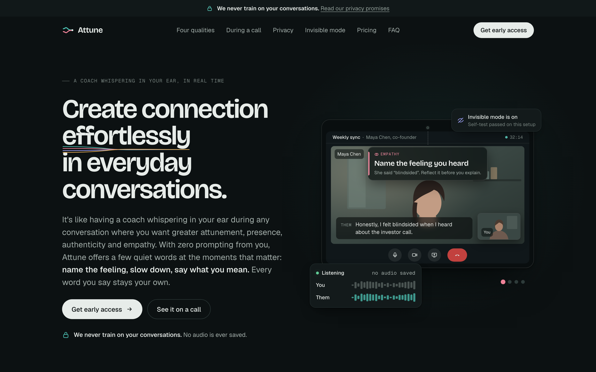

# Attune

**Create Connection Effortlessly In Everyday Conversations**

Our entry for The Big Hack Game, from the team Aligned AI At Scale.

## Start here

- **Live site:** https://attune.ixcoach.com
- **Demo video (4 min 48 s, with sound):** https://youtu.be/nz123tQjZIA. The same video is in this repo: [Attune-demo-720p.mp4](Attune-demo-720p.mp4)
- **Pitch deck (20 slides):** [Attune-pitch-deck.pdf](Attune-pitch-deck.pdf)
- **Attune for iPhone, screen by screen (20 pages):** [Attune-for-iPhone-screen-by-screen.pdf](Attune-for-iPhone-screen-by-screen.pdf)
- **Attune for Mac, screen by screen (19 pages):** [Attune-for-Mac-screen-by-screen.pdf](Attune-for-Mac-screen-by-screen.pdf)
- **"Start here" doc:** https://docs.google.com/document/d/19y05PblYwzHMVzg4_OxxLrYgYml-IPzO-7qWoKyvPpc/edit
- **Everything above in one shared folder:** https://drive.google.com/drive/folders/14R0lid5lHQTYw0H1JCgmG6z4A2fdGo9d

## About Attune

Attune creates an experience similar to having a coach whispering in your ear in real time during any conversation where you want greater attunement, presence, authenticity and empathy.

With zero prompting from you, it offers micro-adjustment style coaching, that help you show up in conversations in a fashion that supports greater presence with yourself, enhancements in listening skills, and enables seeing the other persons perspective more fully.

Built on the foundations that form the field of Developmental Psychology, it is designed to boost self awareness and soft skills in one of the most accelerated learning formats.  Real Time, Experientially, and with Zero additional work for you.

If you or someone you love wants deeper attunement, connection or authenticity out of everyday conversations, give it a try.

The underlying system offers user agency between utilization of HarnessRouter, Claude or IXCoach to augment its after-a-call retrospective reports.   It is available on IOS and Native Osx ( mac ), and has had 2 users ( plus the creator ) as of Nov 19, 2026 with positive measured impact in both sessions.

While most interactions with ai are of a human interacting 1:1 with an agent, this breaks the mold by augmenting a humans interaction with another human to bring about capacity development.

The underlying premise is based on the proven product market fit of Cluelly, but done dramatically better.  Swapping its "cheating" approach for authenticity.

It also crushes at the specific pain points Cluelly customers report:
- Zero non consensual data retention
- Zero additional risk for conversations
- Zero training on users data

## What's in this repository

This repository holds the materials for judging: the description, the decks and the demo. Attune's own code is kept private.
